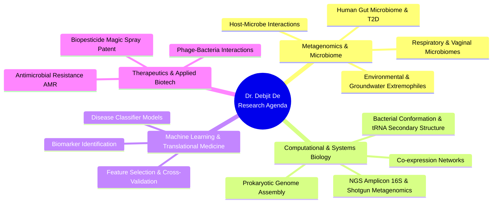

# Dr. Debjit De, Ph.D.
### Assistant Professor | Computational Biologist & Microbiome Data Scientist
**Lovely Professional University | Ex-Swami Vivekananda University | Ex-NIBMG | Ph.D. Jadavpur University**

---

> *"Bridging the bench and the cluster — deciphering host-microbe dynamics, multi-omics biomarkers, and microbial dark matter to advance translational biomedicine."*

---

### 🧬 About Me

I am a computational biologist and bioinformaticist with dual competence in **wet-lab molecular biology** and **computational genomics**. Currently serving as an **Assistant Professor in the Department of Bioinformatics, School of Bio-Engineering and Bio-Sciences, Lovely Professional University**, I previously served as Assistant Professor at Swami Vivekananda University and as a **Senior Research Data Analyst** at the **National Institute of Biomedical Genomics (NIBMG)**.

- 🎓 **Ph.D. in Computational Biology & Applied Microbiology** from Jadavpur University (2015–2023), investigating the gut microbiota of Indian Type 2 Diabetes patients.
- 🔬 **Research Core:** High-throughput 16S amplicon and whole metagenome sequencing (WMS), host-pathogen interactions, antimicrobial resistance (AMR), viral/phage metagenomics, and predictive machine learning.
- 👨‍🏫 **Mentorship & Leadership:** Guided Ph.D. scholar to thesis submission, supervised multiple national & international post-graduate interns, and organized hands-on NGS & bioinformatics workshops.
- 🏆 **Honors:** JU-RUSA 2.0 Doctoral Scholarship (MHRD, Govt. of India); NPTEL-AICTE Elite Topper (Top 1% - 96% in Computational Genomics).

---

### 🔬 Core Research Domains

---

### 💻 Computational & Laboratory Skillset

| Category | Tools & Technologies |
| :--- | :--- |
| **Metagenomics & NGS** | `QIIME 2` `DADA2` `MetaPhlAn` `HUMAnN2` `Trimmomatic` `PEAR` `MOTHUR` `SWARM` `SINA` `SortMeRNA` `DESeq2` |
| **Data Science & ML** | `R` (Bioconductor, ggplot2, vegan, phyloseq), `Python` (pandas, scikit-learn), Supervised/Unsupervised Learning, Bootstrapping, Cross-Validation |
| **Bioinformatics Scripting** | `Perl` / `BioPerl`, `C`, `Bash/Shell Scripting`, `HTML/Web`, High-Performance Computing (HPC) & Linux pipelines |
| **Wet-Lab Competence** | DNA/RNA Extraction, PCR, Microbial Culturing, Genotoxicity Assays (*Drosophila* model), UPLC-MS/MS data interpretation, Nanoparticle Biosynthesis |

---

### 📑 Selected Peer-Reviewed Publications

Here are select articles from my **9+ peer-reviewed journal publications**, **3 book chapters**, and **1 published patent**:

1. **Upper respiratory tract microbiome profiles in SARS-CoV-2 Delta and Omicron infected patients exhibit variant specific patterns and robust prediction of disease groups**  
   *Microbiology Spectrum (ASM)* (2023) | **Impact Factor: 9.0** | [DOI: 10.1128/spectrum.02368-23](https://doi.org/10.1128/spectrum.02368-23)
   
2. **Previse preterm birth in early pregnancy through vaginal microbiome signatures using metagenomics and dipstick assays**  
   *iScience (Cell Press)* (2024) | **Impact Factor: 4.6** | [DOI: 10.1016/j.isci.2024.109156](https://doi.org/10.1016/j.isci.2024.109156)

3. **Insights of host physiological parameters and gut-microbiome of Indian Type 2 Diabetic patients visualized via metagenomics and machine learning approaches**  
   *Frontiers in Microbiology* (2022) | **Impact Factor: 4.0** | [DOI: 10.3389/fmicb.2022.914124](https://doi.org/10.3389/fmicb.2022.914124)

4. **Alteration of Rice Root Endophytic Bacterial Community Composition by *Meloidogyne graminicola* and Identification of Potential Biocontrol Agent**  
   *Annals of Microbiology (Springer)* (2024) | **Impact Factor: 3.0** | [DOI: 10.1186/s13213-024-01784-y](https://doi.org/10.1186/s13213-024-01784-y)

5. **Tissue-Specific Arsenic Bioaccumulation in *Labeo Rohita* and *Catla Catla* Across Contaminated Districts of West Bengal, India**  
   *Bulletin of Environmental Contamination and Toxicology* (2026) | **Impact Factor: 2.2** | [DOI: 10.1007/s00128-026-04210-5](https://doi.org/10.1007/s00128-026-04210-5)

6. **The differences in SARS-CoV and SARS-CoV-2 specific co-expression network mediated biological process in human gut enterocytes**  
   *Infection, Genetics and Evolution (Elsevier)* (2021) | **Impact Factor: 2.6** | [DOI: 10.1016/j.meegid.2021.104892](https://doi.org/10.1016/j.meegid.2021.104892)

7. **Microbial communities of the drinking water with gradient radon concentration are primarily contributed by radon and heavy metal content**  
   *Frontiers in Environmental Science* (2021) | **Impact Factor: 3.3** | [DOI: 10.3389/fenvs.2021.576400](https://doi.org/10.3389/fenvs.2021.576400)

8. **Book Chapter:** *Role of the gut microbiome in the pathogenesis of inflammatory bowel disease*  
   Banerjee, S., Adhikary, P., **De, D.**, Kalam, A., Chowdhury, S., & Mal, C. (2026). *The Gut Microbiome in Precision Medicine: From Research to Clinical Practice* (pp. 341–353). Academic Press (Elsevier). [DOI: 10.1016/B978-0-443-40483-2.00021-2](https://doi.org/10.1016/B978-0-443-40483-2.00021-2)

9. **Book Chapter:** *Metagenomics and bioinformatics in microbial ecology: Current status and beyond*  
   *Elsevier: Applications of Metagenomics* (2023) | [DOI: 10.1016/B978-0-323-98394-5.00009-2](https://doi.org/10.1016/B978-0-323-98394-5.00009-2)

---

### 💡 Intellectual Property & Patents

* **Published Patent:** *Biopesticide Magic Spray*  
  - **Application No.:** `202531022109` | **Filing Date:** March 12, 2025 | **Published Date:** March 21, 2025

---

### 🎓 Teaching & Mentorship

- **Ph.D. Supervision:** Research Supervisor for doctoral scholar Mr. Navaneet Dey (*"Physiological Assessment of Different Types of Honey and Development of a New Protocol for Multi Residual Menaces"*).
- **Internship Training:** Trained research interns from Presidency University, Calcutta University, Chandigarh University, and Asian University for Women.
- **Courses Taught:** Introduction to Bioinformatics, Genomics & Proteomics, Molecular Evolution, Perl & BioPerl, R Programming for Life Sciences.
- **Workshops Organized:** Hands-on training on Next-Generation Sequencing (NGS) Data Handling, Metagenomics pipelines, and Drug Discovery at Swami Vivekananda University and NIBMG.

---

### 📊 GitHub Activity & Metrics

  
  

  

---

### 📬 Get in Touch

- 🏢 **Affiliation:** Department of Bioinformatics, School of Bio-Engineering and Bio-Sciences, Lovely Professional University, Phagwara, Punjab, India
- 📧 **Direct Email:** [de.debjit92@outlook.com](mailto:de.debjit92@outlook.com)
- 💼 **LinkedIn:** [Dr. Debjit De on LinkedIn](https://www.linkedin.com/in/dr-debjit-de-207732171/?isSelfProfile=true)
- 💻 **GitHub:** [github.com/debjitde01](https://github.com/debjitde01)
- 🎓 **Google Scholar:** [Dr. Debjit De on Google Scholar](https://scholar.google.com/citations?hl=en&user=-j-7-_AAAAAJ&view_op=list_works&gmla=AERr9JGo0k52wnOcxiFRuRNhbO0Ud8AL7P9JXvN9v356zM_AaW01iPIZopL0tyGhWC1b4TxN0V6s43CngreG5NoC)
- 🆔 **ORCID:** [0009-0004-7613-9241](https://orcid.org/0009-0004-7613-9241)
- 🌐 **Portfolio Website:** *Explore my interactive web portfolio on GitHub Pages!*

  Designed with precision for computational genomics & translational research • © Dr. Debjit De

